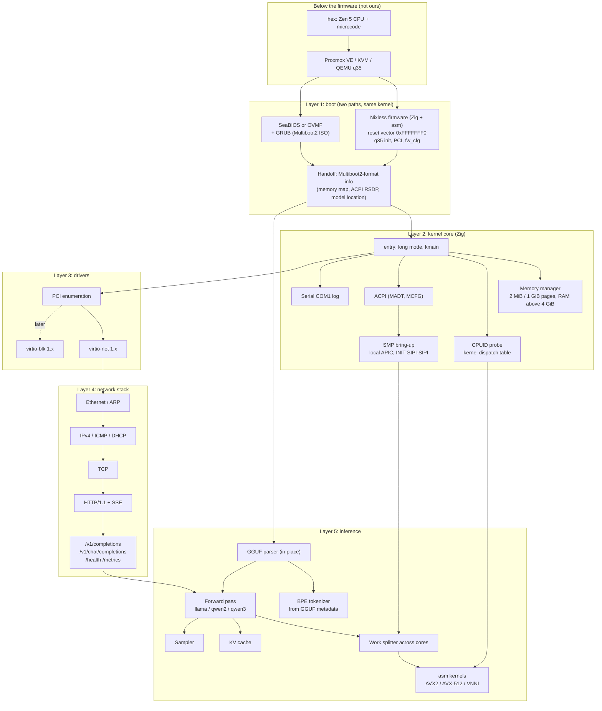

# Nixless: PRD and design

Status: draft v0.6, 2026-11-26. No OS code exists yet. This document is the product requirements and design that Larry builds from, in the herdr pane `larry:herdr:nixless` (`/home/pi/nas/Projects/nixless`).

Nixless is Fred Nix's own operating system, written from scratch, from the firmware up. It powers on, runs its own firmware, hands off to its own kernel, loads a language model and serves it over a network API. There is no shell, no userland and no disk requirement. It is an AI appliance that runs as a small, disposable VM on hex.

An existing third-party bare-metal LLM OS ("the yardstick OS") is used as an external benchmark yardstick.

## 0. Top-level invariant: always bootable on hex

Fred's rule (2026-11-26): Nixless must always be bootable on hex/Proxmox.

- Every milestone and every commit on `main` must produce an ISO that boots in a Proxmox VM on hex and reaches its boot log on serial.
- The target VM shape: `machine: q35`, `cpu=host`, diskless, virtio-net attached, serial0 socket. The ISO must boot under both SeaBIOS and OVMF (UEFI) through GRUB.
- From the firmware milestone (M5) on, the Nixless firmware image must also boot the same kernel on hex via `args: -bios <file>`. The GRUB ISO path keeps working for the life of the project, so the invariant never depends on the newest layer.
- The Proxmox boot check (section 14.1) is the gate for every milestone. A milestone is not done until it passes.
- A change that breaks the boot check is fixed or reverted before anything else lands on `main`.
- hex VM starts and stops, and any file placement on the hex host (for example the firmware image for `-bios`), go through Proxmox Expert, the Grok bot that owns hex. Larry may act directly with his own root access when Fred or the plan asks for it.

## 0b. Top-level invariant: a good Proxmox neighbor

Fred's rule (2026-11-26), from a real hex observation: a bare-metal LLM OS that busy-spins every vCPU while idle shows up as about 1500% host CPU for a 16 vCPU guest and pushed hex load to 25. hex is shared (larry VM 105, ComfyUI, cm-t2, nas), so Nixless must never do that.

- Idle cores halt. When a core has no work it executes HLT (or MWAIT where CPUID and the hypervisor expose it) with interrupts enabled, and wakes on an interrupt: LAPIC timer, IPI, or virtio IRQ. Under KVM a halted vCPU costs the host nothing.
- Worker cores park when there is no request. The BSP wakes them with an IPI when it publishes work, and they halt again when the request finishes.
- Spin-waits (barriers, queue polls) use PAUSE in a bounded loop (target a few microseconds, tuned in M1 and M6), then fall back to HLT and wait for an IPI. No unbounded spin anywhere.
- The network path is interrupt-driven (virtio-net MSI-X). Polling is allowed only in a bounded burst while a request is in flight.
- No tick storms: the LAPIC timer runs one-shot (or TSC-deadline) for the next real deadline (TCP retransmit, DHCP renew), not a fast periodic tick.
- Firmware too: the Nixless firmware halts APs it does not use and never spins waiting for anything without a bound.
- Target: an idle Nixless VM, booted with a model loaded and no requests, uses under 2% of one host core on average, measured from the hex host (section 14.1).

## Start here: M0

M0 is the only thing being built (scope and exit in section 16). It needs no network, no model and no SMP.

- Status 2026-11-26: M0 plus the first slice of M1 exist: the Zig kernel, Multiboot2 stub, hybrid ISO, `scripts/qemu-boot-check.sh`, a GDT with TSS and IST stacks, an IDT on all 32 exception vectors, the panic dump with a frame-pointer backtrace, the Multiboot2 memory map, and `scripts/panic-check.sh` (page fault, divide error, invalid opcode, double fault, assertion; all pass). Still M1: page tables above 4 GiB with guard pages, frame allocator, ACPI, LAPIC, TSC, SMP, CPUID and AVX state, and the stack-overflow panic test. The banner prints under SeaBIOS and OVMF in local QEMU on q35. Not yet done: the same check on hex, which needs the q35 VM and OVMF variant from Proxmox Expert (request sent 2026-11-26).
- Build: `zig build iso`, then `scripts/qemu-boot-check.sh [seabios|ovmf]`. Toolchain notes are in 13.1. Larry's user is not in the `kvm` group, so local runs use TCG until that changes; the script uses KVM when `/dev/kvm` is writable.

## 1. Product requirements

### 1.1 Who it is for

Fred, and NixNet. A Nixless VM is an inference appliance: boot it, point an HTTP client at it, get tokens back. It is also a learning lab for how inference speed really works, all the way down to the reset vector.

### 1.2 Requirements

| ID | Requirement | Priority |
| --- | --- | --- |
| R1 | Boots on hex in a Proxmox VM on every commit (section 0) | Must |
| R2 | Boots straight into a loaded model, no shell, no userland | Must |
| R3 | Loads GGUF models: llama, qwen2, qwen3 architectures; F16, Q8_0, Q4_K, Q6_K | Must (Q4_K/Q6_K in M7) |
| R4 | OpenAI-compatible-ish HTTP API over virtio-net, with SSE streaming | Must |
| R5 | Greedy output matches llama.cpp token-for-token on the same GGUF | Must |
| R6 | Uses all vCPUs and the best SIMD available (AVX2, AVX-512, VNNI), chosen at boot | Must |
| R7 | Own firmware in Zig and asm, booting the kernel on QEMU q35 with no GRUB, SeaBIOS or OVMF | Must (M5) |
| R8 | Deterministic output for a fixed seed and core count | Should |
| R9 | Decode tok/s at parity with or better than llama.cpp on hex at equal vCPUs, reported with the share of memory bandwidth reached (1.4) | Goal, measured honestly |
| R10 | Serial COM1 boot log and debug only | Must |
| R11 | Good Proxmox neighbor: idle cores HLT, workers park, bounded PAUSE spins, near-zero host CPU when idle (section 0b) | Must |
| R12 | Fails loud and quiet: every fatal error prints a stable code and CPU state on serial, then halts with the VM idle (section 6b) | Must |
| R13 | One model per boot, delivered by ISO module, fw_cfg file or read-only virtio-blk disk, sized and checked before use (section 9b) | Must |

### 1.3 Non-goals (v1)

- No shell, no userland processes, no system calls, no POSIX.
- No filesystem. The model arrives as a Multiboot2 module (GRUB path) or a QEMU fw_cfg file (Nixless firmware path), later virtio-blk or network.
- No GPU offload. CPU inference only.
- No graphics. Serial is the console.
- No TLS in v1. Nixless lives on a private network (tailnet or LAN behind a proxy).
- Not every GGUF architecture. v1 is llama, qwen2 and qwen3.
- No training, no fine-tuning, no multi-model hosting.
- No real-hardware drivers beyond what QEMU/KVM exposes.
- Nothing below our firmware (section 5).

### 1.4 Success targets

Provisional until measured. Results are never rounded in our favor.

| Area | Target | Checked in |
| --- | --- | --- |
| Correctness | 64 greedy tokens identical to llama.cpp on Qwen3-0.6B Q8_0, both boot paths | M3, M5 |
| Decode speed | Parity with llama.cpp at equal vCPUs is a good result, better is a win. Report the share of measured memory bandwidth reached. | M6 |
| Idle cost | Under 2% of one host core (section 0b) | M1 onward |
| Wake latency | Under 1 ms added, all cores parked to first token | M1, M4 |
| Kernel to ready | Under 1 s from kernel entry to the ready line, excluding model load | M3 |
| Determinism | Same prompt, seed and core count gives identical bytes over 10 runs | M3 onward |

"Useful" means: a client sends a chat completion to the VM's IP and gets a streamed answer, and a script can create, use and destroy the VM with no one on the console. Boot-to-ready and snapshot-clone times are measured and reported first; they get targets after M5 and M6.

## 2. Architecture



Key design choice: both boot paths hand the kernel the same thing, a Multiboot2-format boot information structure. The Nixless firmware builds that structure itself. The kernel has one info contract and two entry points: the Multiboot2 entry in 32-bit protected mode (GRUB, path A) and a documented 64-bit entry (Nixless firmware, path B). Both end in the same `kmain`, so the GRUB ISO stays a working fallback forever at almost no extra kernel cost.

Decided (Fred, 2026-11-26): the firmware calls the 64-bit entry directly. It does not drop back to 32-bit to fake a GRUB handoff.

Execution model: the bootstrap processor (BSP) runs the network loop and request queue. Application processors (APs) halt until the BSP sends an IPI with work, take slices of matrix work, then halt again. No preemptive scheduler. Interrupt-driven I/O (virtio-net, one-shot timer); short bounded polling only while a request is in flight (section 0b).

## 3. Boot path A: GRUB ISO (M0 onward, kept forever)

### 3.1 Loader

- GRUB 2 with Multiboot2 (spec: https://www.gnu.org/software/grub/manual/multiboot2/multiboot.html).
- Kernel is an ELF64 image with a Multiboot2 header in the first 32 KiB, requesting the memory map, module info, and ACPI RSDP tags (old and new).
- Model passed as a Multiboot2 module: `module2 /models/model.gguf model`.
- One hybrid ISO boots under SeaBIOS (GRUB i386-pc) and OVMF (GRUB x86_64-efi). `grub-mkrescue` builds it when both GRUB platforms are installed. Nixless does not use UEFI runtime services.
- Known limit: GRUB places modules below 4 GiB, so module-delivered models top out around 3 GiB. The Nixless firmware path (fw_cfg) and later virtio-blk remove this limit.

### 3.2 Entry to long mode

References: Intel SDM Vol. 3, AMD APM Vol. 2, osdev wiki.

1. Enter in 32-bit protected mode per Multiboot2. Save the info pointer.
2. Check CPUID for long mode, halt with a serial message if missing.
3. Build boot page tables: identity map the first 4 GiB with 2 MiB pages plus a higher-half kernel mapping. (M0 is identity only, linked at 1 MiB with code model `small`; the higher half lands in M1 with the memory map.)
4. Enable PAE, set EFER.LME and NXE, load CR3, enable paging, far jump to 64-bit code.
5. 64-bit GDT, stack, zero BSS, enable SSE, call `kmain`.
6. Enable AVX and AVX-512 state: CR4.OSXSAVE, XCR0 bits for x87, SSE, AVX, opmask, ZMM_Hi256, Hi16_ZMM when CPUID reports them (leaf 0xD).

## 4. Boot path B: Nixless firmware (M5)

Our own BIOS replacement in Zig and asm. It replaces SeaBIOS, OVMF and GRUB on QEMU's q35 machine and boots the Nixless kernel and model directly.

### 4.1 Scope

- Target: QEMU `-machine q35` with KVM, as Proxmox runs it. Not real hardware.
- Loaded by QEMU as the system ROM: `-bios nixless-fw.bin`. QEMU maps the image so it ends at 4 GiB, and the CPU starts at the reset vector 0xFFFFFFF0 in 16-bit real mode with CS base 0xFFFF0000.
- Image size: a fixed power of two (start with 256 KiB, allowed up to a few MiB), padded so the reset vector sits in the last 16 bytes.
- No legacy BIOS services (no INT 10h, INT 13h, INT 15h) and no UEFI services. Nixless is the only payload, so the firmware only needs to do what the Nixless kernel needs.

### 4.2 Stages

1. Reset vector (asm, 16-bit): jump to the early entry, disable interrupts, load a minimal GDT from ROM.
2. Real to protected mode (asm): set CR0.PE, far jump to 32-bit code, set flat segments. There is no RAM setup to do on QEMU: guest RAM works from the first instruction. (On real hardware this is where memory training would happen; see section 5.)
3. Protected to long mode (asm): build temporary page tables in low RAM, enable PAE, EFER.LME, paging, jump to 64-bit Zig code with a stack in RAM.
4. Copy the firmware's data and BSS from ROM to RAM (ROM is read-only).
5. Serial: init COM1 and print `nixless-fw <version> <shorthash>`.
6. q35 chipset init (from the Intel ICH9 and Q35/MCH datasheets and QEMU's q35 documentation): program PCIEXBAR to enable PCIe ECAM, set up the PAM registers so the low BIOS area behaves as RAM, set up SMRAM as closed (no SMM use), configure the LPC/ISA bridge enough for COM1, the PIT and ACPI PM timer.
7. PCI enumeration: walk buses via ECAM, size each BAR, assign MMIO and I/O windows (32-bit window below 4 GiB, 64-bit window above RAM), enable bus mastering for virtio devices, route legacy interrupts or leave devices for MSI-X.
8. fw_cfg (QEMU firmware configuration interface, documented in QEMU `docs/specs/fw_cfg.rst`): detect the signature at I/O 0x510/0x511, use the DMA interface at 0x514 for bulk reads. Read:
   - `etc/e820` for the RAM map (this is how RAM size above and below 4 GiB is discovered),
   - `etc/table-loader`, `etc/acpi/tables`, `etc/acpi/rsdp` to install QEMU's generated ACPI tables (linker/loader commands: allocate, add pointer, add checksum),
   - the kernel ELF and the GGUF model as fw_cfg files (for example `opt/nixless/kernel` and `opt/nixless/model`, passed with `-fw_cfg name=opt/nixless/model,file=<path>`), or via the standard `-kernel` items.
9. Load: parse the kernel ELF64 and place its segments. DMA the GGUF straight to a large RAM region, above 4 GiB when the VM has it, so model size is limited by VM RAM, not a loader.
10. Handoff: build a Multiboot2-format info structure (memory map from e820, ACPI new RSDP tag, a module tag pointing at the model, a command line tag with Nixless boot flags), then jump to the kernel's 64-bit entry point with the info pointer in RDI. Decided 2026-11-26: no drop back to 32-bit protected mode. Proposed entry contract, to be finalized in M5:
    - CPU in 64-bit long mode, interrupts disabled, direction flag clear.
    - Paging on, with the first 4 GiB identity mapped plus the RAM that holds the kernel and model. The kernel builds its own page tables and GDT right away and does not rely on the firmware's.
    - A valid stack in RAM, 16-byte aligned, at least 16 KiB.
    - RDI = physical address of the Multiboot2-format info structure. No other register is meaningful.
    - The entry address comes from a Nixless ELF note in the kernel image, so the firmware never hard-codes it.
11. APs stay in their reset wait state. The kernel starts them with INIT-SIPI-SIPI, as on path A.

### 4.3 Running it on Proxmox

- A Proxmox VM with `machine: q35`, `bios: seabios` (so Proxmox does not add pflash), and `args: -bios /path/on/hex/nixless-fw.bin -fw_cfg name=opt/nixless/kernel,file=... -fw_cfg name=opt/nixless/model,file=...`.
- Setting `args` needs root on the Proxmox host, and the files must live on the hex host filesystem. Both go through Proxmox Expert. Proposed location: `/mnt/hexfiles/nixless/fw/` (Proxmox Expert to confirm).
- The same VM can switch back to the GRUB ISO by removing `args`, so the boot check can run both paths on one VM or on two VMs in pool `nixless`.

### 4.4 Firmware size and quality targets

- Small and readable over clever. Target under 64 KiB of code for the firmware itself.
- Firmware boot to kernel handoff: target under 50 ms, excluding the model DMA.
- Every chipset register write cites its datasheet section in a comment.

## 5. Below the firmware

Nixless goes as low as software can go in a VM. Below our firmware is a layer we do not and cannot write.

- In a VM on hex: everything under the Nixless firmware is the hypervisor (Proxmox VE, Linux KVM, QEMU's machine model and virtual devices) and the host CPU's microcode. The "q35 chipset" our firmware programs is QEMU's emulation of it. The reset vector is real CPU behavior, but the CPU is a KVM virtual CPU.
- On real hardware (out of scope): that layer would be the CPU microcode, the AMD Platform Security Processor (PSP) or Intel Management Engine (ME), and vendor-signed memory training and silicon init (AMD AGESA/openSIL, Intel FSP). These are signed or undocumented, and they run before any x86 code. A Nixless real-hardware port would have to sit on top of them, as coreboot does.
- Far future, noted only: QEMU's virtual devices are open source, and a hypervisor of our own is imaginable, but writing a hypervisor is out of scope for Nixless.

## 6. Memory plan

Planning targets, not measured.

| Region | Size | Notes |
| --- | --- | --- |
| Low memory (< 1 MiB) | small | AP trampoline; firmware scratch before handoff. |
| Firmware ROM | 256 KiB image | Mapped below 4 GiB by QEMU. Not used after handoff. |
| Kernel image | target < 512 KiB | Code, rodata, data, BSS. |
| Per-core stacks | 64 KiB x cores | Guard page below each. |
| Per-core scratch | 1 to 8 MiB x cores | Quantized activations, partial sums. |
| Model weights | size of GGUF | Used in place. No copy after load. |
| Activations | a few MiB | Allocated once at model load. |
| KV cache | layers x 2 x kv_heads x head_dim x ctx x bytes | F16 default, F32 option for determinism tests. Sized from `ctx` at boot. |
| Network buffers | 2 to 8 MiB | virtio rings, RX/TX buffers, TCP windows. |

- Paging: direct map all RAM at a fixed offset with 1 GiB pages when CPUID reports pdpe1gb, else 2 MiB pages. Covers RAM above 4 GiB so large models fit. Weights read-only, kernel text read-only and executable, data NX.
- Allocator: physical frame allocator over the memory map, plus bump arenas per subsystem. No general heap in v1. Everything is sized at model load, so steady-state inference never allocates.
- Example: Qwen3-0.6B Q8_0 at ctx 4096 needs about 610 MiB of weights, about 448 MiB of F16 KV cache and about 64 MiB of everything else. A 2 GiB VM is enough. 7B to 8B at Q4_K wants 8 to 16 GiB.

## 6b. Panic and failure behavior

Decided 2026-11-26 (Fred): halt, dump, stay idle. Principle: when Nixless fails it says so loudly on serial, then goes quiet and cheap. It never spins, never reboots by itself and never leaves the operator guessing.

| Class | Examples | Behavior |
| --- | --- | --- |
| Request error | malformed HTTP, prompt longer than ctx, queue full, client gone | HTTP 4xx or 5xx, or close the connection. A counter goes up. Never a panic (14.5). |
| Boot-fatal | no model, bad GGUF, unsupported tensor type, not enough RAM, no virtio-net | One line `nixless: FATAL <CODE>: <detail>`, then the halt state below. |
| Kernel panic | CPU exception, failed assertion, stack guard hit, broken invariant | The panic procedure below. |
| Firmware fatal | no fw_cfg, kernel ELF invalid, empty e820 | `nixless-fw: FATAL <CODE>: <detail>`, then the halt state below. |

Fatal codes are stable strings the boot check greps for: `E_NO_MODEL`, `E_GGUF_BAD`, `E_GGUF_TYPE`, `E_ARCH_UNSUPPORTED`, `E_OOM`, `E_NO_NIC`, `E_NO_LONGMODE`, `E_NO_ACPI`. The list grows with the milestones. A new failure path gets a code in the same commit that adds it.

Panic procedure, on the core that faults:

1. Mask interrupts and take the panic flag with one atomic compare-exchange. A core that loses the race HLT-loops with interrupts masked, so two simultaneous faults print once, not interleaved.
2. Send an NMI to every other core so they stop computing. Wait a bounded time (a few milliseconds by TSC). A core that does not answer is named in the dump and ignored.
3. Print on COM1, polled, with no allocation and no locks: `nixless PANIC: <reason>`, version and shorthash, core and APIC id, exception vector and error code, RIP, RSP, RFLAGS, CR0, CR2, CR3, CR4, all general registers, a frame-pointer backtrace as raw addresses (the host resolves them against the ELF with `addr2line`), the model name, the phase (boot, prefill or decode) and the request count. The earlier log lines are already on serial, so there is no log ring.
4. Halt state: `cli; hlt` in a loop. An NMI wakes the HLT and the handler returns to the loop. The VM stays "running" in Proxmox at near-zero host CPU, which keeps section 0b true even when broken.

Also decided here:

- No automatic reboot by default: a reboot loop reloads the model from hex again and again and hides the failure. A halted VM keeps its RAM for `qm monitor`. `panic=reboot` is an opt-in flag. A watchdog is out of v1.
- Panics are visible from outside as `/health` going silent plus `PANIC` or `FATAL` on serial. Proxmox still says "running", so the boot check reads serial.
- The IDT is installed first in M1. Double fault, NMI and machine check use IST stacks; every per-core stack has a guard page (`STACK OVERFLOW core N`).
- The kernel ships as ReleaseSafe; only the hand-tuned matmul and attention kernels run unchecked, on tensor ranges validated at load. Zig's panic handler calls the procedure above.
- Test builds can exit QEMU after the dump via `isa-debug-exit` (port 0xF4). That device is never on the hex VM.

## 7. Drivers

- Serial (COM1): 16550 UART at I/O 0x3F8, 115200 8N1, polled. Boot log, panics, debug dump only.
  - Kernel banner (asserted by the boot check): `nixless <version> <shorthash> booting`.
  - Firmware banner (path B): `nixless-fw <version> <shorthash>`.
  - Ready line: `nixless ready model=<name> arch=<arch> quant=<type> ip=<addr> port=<port>`.
- PCI: q35 only (decided 2026-11-26). ECAM via ACPI MCFG is the main path; legacy config ports 0xCF8/0xCFC are used only before MCFG is parsed. Find virtio devices by vendor 0x1AF4 and their virtio 1.x capability structures. On path B the firmware has already assigned BARs; on path A SeaBIOS or OVMF has.
- Time: the TSC is the clock. At boot the kernel requires an invariant TSC and calibrates it once against the ACPI PM timer over a bounded window of a few tens of ms. `uptime_ms`, timeouts and the TCP timer all derive from it. The LAPIC timer runs TSC-deadline when available, else one-shot. Wall time is best effort: the CMOS RTC is read once at boot as UTC, `created` is `rtc_at_boot + uptime`, no NTP in v1. A snapshot-restored VM keeps its old wall time. Whether Proxmox exposes the hypervisor TSC leaf `0x40000010` is checked in M1; the PM timer is the fallback.
- virtio-net (OASIS VIRTIO 1.2, section 5.1): modern devices only. Negotiate VERSION_1, MAC, STATUS. No offloads in v1. One RX/TX queue pair, split virtqueues, MSI-X with polling fallback. Proxmox: `--net0 virtio,bridge=vmbr0`.
- virtio-blk (later, M7): read-only, GGUF at a fixed offset. No filesystem.

## 8. Network stack scope

Minimal, following the RFCs. One IPv4 address, one listening port.

| Layer | v1 scope | Reference |
| --- | --- | --- |
| Ethernet II | Unicast and broadcast RX/TX | IEEE 802.3 |
| ARP | Replies, small cache, gateway resolution | RFC 826 |
| IPv4 | Header checksum, drop fragments | RFC 791 |
| ICMP | Echo reply only | RFC 792 |
| DHCP | Client (discover, request, renew); static IP option on the command line | RFC 2131 |
| TCP | Server only, up to 16 connections, retransmit timer, MSS, basic window. No SACK or window scaling in v1 | RFC 9293, RFC 6298 |
| HTTP/1.1 | Request line, headers, Content-Length bodies, keep-alive, chunked for SSE | RFC 9110, RFC 9112 |
| SSE | `text/event-stream`, `data:` lines | WHATWG server-sent events |
| JSON | Small parser and writer for API bodies | RFC 8259 |

No IPv6, TLS or DNS in v1.

M4 is built in two steps so the first working `curl` comes early (proposed 2026-11-26):

| Step | TCP and HTTP scope | Done when |
| --- | --- | --- |
| M4a | One active connection at a time. Fixed 1 s retransmit timeout with a small retry limit. Out-of-order segments are dropped and the peer retransmits. Fixed receive window equal to the RX buffer. MSS 1460, Nagle off. HTTP requests with `Content-Length` bodies only, a chunked request body gets 411, a request over 64 KiB gets 413. `Connection: close` is always honored. SSE streams chunked. | `curl` completions and streamed chat work against the VM on hex |
| M4b | Up to 16 connections. RTT-estimated retransmit timeout (RFC 6298), keep-alive, an idle timeout, zero-window probing, FIN and RST edge cases. | The 14.5 test set passes: 16 concurrent connections, mid-stream disconnects, malformed HTTP, loss and reorder injection |

Escape hatch (Fred's call, not a quiet fallback): if the TCP stack stalls the schedule, the API can move to virtio-vsock or virtio-console with a small proxy on hex. Tests: parsers host-side on recorded packets, the whole stack in local QEMU on a TAP device with `tc netem` for loss and reorder.

## 9. GGUF loader

- Spec: GGUF documentation in the ggml repository (`docs/gguf.md`), version 3.
- Parse header (magic `GGUF`, version, counts), metadata key/values, tensor infos. Respect `general.alignment` (default 32).
- Tensors are used in place where the model was loaded (module or fw_cfg region). An optional boot-time repack into a kernel-friendly layout comes later only if benchmarks justify it.
- Validate every tensor's type, shape and byte range before use. A malformed file halts with a clear serial message, never a fault.
- Architecture from `general.architecture`; hyperparameters from `<arch>.*` keys.
- v1 tensor types: F32 (norms), F16, Q8_0. M7 adds Q4_K and Q6_K (Q6_K is common for output tensors in Q4_K_M files). Unsupported types halt with the tensor name and type printed.
- Block formats come from public ggml documentation and are verified against test vectors from the `gguf` Python package.

Tokenizer, from GGUF metadata:

- `tokenizer.ggml.model` (byte-level BPE for qwen2, qwen3, llama-3), `tokens`, `merges`, `token_type`, BOS/EOS ids.
- Pre-tokenizer split rules hand-written per supported family (no regex engine), chosen by `tokenizer.ggml.pre`.
- Chat templates hand-written per family (ChatML for qwen, llama-3 format). `tokenizer.chat_template` is logged, not executed.

## 9b. Model delivery

One rule drives it: one VM, one model, one boot. Switching models means changing the VM config and starting it again (the VM is disposable). Nixless never writes to a model.

Where models live: on hex's `hexfiles` volume (`/mnt/hexfiles`, 76 GiB free when checked read-only on 2026-11-26; `/mnt/hexfiles/nixless/` does not exist yet). Library (Larry owns it, using his own hex access; decided 2026-11-26): `/mnt/hexfiles/nixless/models/<name>.gguf`, named like `qwen3-0.6b-q8_0.gguf`, each next to a `<name>.gguf.sha256`. Model files never go in this repo (it is public); `models/` is git-ignored.

| Mode | Path | Size limit | How it is attached | When |
| --- | --- | --- | --- | --- |
| ISO module | A | about 3 GiB (GRUB loads modules below 4 GiB) | `zig build iso -Dmodel=...` bakes it in | M0 to M3, small models, one self-contained ISO |
| fw_cfg file | B | VM RAM | `args: -fw_cfg name=opt/nixless/model,file=<hex path>` | M5 |
| virtio-blk, read-only raw disk | A or B | disk size | the GGUF placed at offset 0 of a raw file or volume, attached with `qm set` and `ro=1` | M7 |
| HTTP fetch at boot | none | none | not in v1 | rejected: needs the whole M4 network stack before the model can load |

Sizing rule: the VM needs weights + KV cache for `ctx` (section 6) + about 64 MiB working memory + network buffers + kernel, times 1.1. The kernel checks at boot and halts with `E_OOM need=<bytes> have=<bytes>` instead of faulting. Ballooning stays off (`balloon 0`), because weights are used in place.

Integrity: the GGUF loader validates every range before use (section 9), and the boot check script verifies the file's sha256 against its sidecar before attaching it. `/health` reports `model_bytes`.

Load time: on the fw_cfg path the host file is copied into guest RAM on every boot, so load time is about model size over host read speed. Serial and `/metrics` report `boot_ms` and `model_load_ms`.

Provenance: every benchmark and golden-test record names the model file, its size and its sha256, so a result can be reproduced against the same bytes.

## 10. Inference engine

### 10.1 Forward pass

From the public model descriptions and configs (Llama papers, Qwen2 and Qwen3 technical reports, Hugging Face configs):

- Embedding lookup (dequantize one row).
- Per layer: RMSNorm; Q, K, V projections (qwen2 has QKV bias, qwen3 has per-head RMSNorm on Q and K); RoPE; grouped-query attention over the KV cache; output projection; residual; RMSNorm; SwiGLU MLP; residual.
- Final RMSNorm, output projection (or tied embeddings), logits.
- Activations in F32. Weights stay quantized. Each matrix-vector op quantizes the activation vector once (to 8-bit blocks) and uses integer dot products where the weight format allows.

### 10.2 Threading across cores

- Decode is a chain of matrix-vector products. Each op splits output rows into contiguous chunks, one per core.
- The BSP publishes a work descriptor and wakes parked cores with an IPI; all cores including the BSP run their slice; a barrier on a shared counter ends the op (bounded PAUSE spin, then HLT). No locks. Between requests every AP is halted.
- Attention splits across heads.
- Prefill is token by token in v1. Batched prefill comes later and is reported honestly in benchmarks.
- Fixed partitioning and fixed reduction order make deterministic output possible.

### 10.3 KV cache

- One contiguous region per layer, F16 default, sized from the boot `ctx`.
- One sequence at a time in v1; requests queue. Prefix reuse when a new prompt shares a prefix with the previous one.
- The KV cache lives at a documented location so a future snapshot-clone feature can find it.

### 10.4 Sampling

- Greedy (argmax, ties to the lowest token id) for every benchmark and golden test.
- Temperature, top-k, top-p, min-p, repetition penalty.
- Seeded PRNG (chosen and documented in code).
- Stop on EOS, stop strings or `max_tokens`.

## 11. asm kernel plan

Zig owns structure. Hand-written x86-64 assembly owns inner loops.

| Kernel | AVX2 path | AVX-512 / VNNI path |
| --- | --- | --- |
| Q8_0 x Q8 dot | VPMADDUBSW / VPMADDWD with sign handling, F32 FMA for scales | VPDPBUSD (AVX512_VNNI), 512-bit |
| Q4_K x Q8 dot | Nibble unpack (VPSHUFB, VPAND), integer dot | VPDPBUSD, mask registers for tails |
| Q6_K x Q8 dot | 6-bit unpack, integer dot | Same, 512-bit |
| F16 x F32 dot | VCVTPH2PS + FMA | 512-bit convert + FMA, BF16 or FP16 instructions where present |
| Activation quantize | AVX2 | AVX-512 |
| RMSNorm, softmax, SiLU, RoPE | Zig `@Vector`, asm only if profiling says so | Same |

- CPUID is probed once at boot; a dispatch table picks the best variant; the choice is printed on serial and exposed in `/metrics`.
- Every asm kernel has a plain Zig reference. Tests require exact match for integer paths and tight tolerance for float paths.
- A boot flag forces the AVX2 path on AVX-512 machines for fair comparisons.
- Zen 5 runs AVX-512 at full 512-bit width, so the VNNI path is the main bet on hex.

## 12. API spec

Base `http://<ip>:8080`, JSON bodies. No auth in v1 (private network); an optional static bearer token from the command line is planned.

- `GET /health` returns `200 {"status":"ok","model":"<name>","arch":"qwen3","quant":"Q8_0","ctx":4096,"boot_path":"grub|nixless-fw","uptime_ms":12345}`.
- `GET /metrics` returns Prometheus text: requests, prompt and generated tokens, last prefill and decode tok/s, cores, SIMD path, KV tokens used, memory used, network bytes.
- `POST /v1/completions`, request `{"prompt":"...","max_tokens":64,"temperature":0,"top_p":1,"top_k":0,"seed":1,"stop":["..."],"stream":false}`, response in the OpenAI text completion shape with `usage`.
- `POST /v1/chat/completions`, request `{"messages":[...],"max_tokens":256,"temperature":0.7,"stream":true}`. Non-streamed responses use the OpenAI chat completion shape. Streamed responses are SSE: one `data: {"choices":[{"delta":{"content":"..."}}]}` per token, then `data: [DONE]`.
- Nixless extensions: `"logprobs_top": N` (top N token ids and logprobs per step, used by golden tests), `"return_token_ids": true`.
- Errors: `400` bad request, `413` prompt longer than ctx, `503` queue full. Body `{"error":{"message":"...","type":"..."}}`.

## 13. Build and run

### 13.1 Toolchain

- Zig 0.16.0, pinned in `mise.toml` and `build.zig.zon` (decided in M0). Zig has no Debian 13 package, so mise installs it.
- Zig 0.16 needs its cache on local disk: the NAS NFS mount makes its atomic rename fail with EINVAL. Set `ZIG_LOCAL_CACHE_DIR` and `ZIG_GLOBAL_CACHE_DIR` to a local path (for example `~/.cache/nixless-zig/{local,global}`) before `zig build`.
- The kernel uses the LLVM backend (`use_llvm = true`): with SSE disabled the self-hosted x86 backend cannot encode what the standard library emits.
- Kernel target `x86_64-freestanding-none`, red zone off, no SSE in early boot code, code model `small` in M0 and `kernel` once the higher half exists (M1).
- Firmware: Zig plus asm, built as a flat binary with a linker script that places the reset vector at the end of the image. 16-bit and 32-bit entry code in asm.
- `grub-mkrescue` with `grub-pc-bin`, `grub-efi-amd64-bin`, `xorriso`, `mtools` for the hybrid ISO.
- QEMU with KVM, plus OVMF for UEFI tests.
- Builds run on host larry in `/home/pi/nas/Projects/nixless`.

### 13.2 Commands (target shape)

```
zig build                      # kernel: zig-out/bin/nixless.elf
zig build firmware             # firmware: zig-out/bin/nixless-fw.bin (from M5)
zig build test                 # host-side unit tests
zig build iso -Dmodel=models/qwen3-0.6b-q8_0.gguf   # zig-out/nixless.iso
zig build run                  # QEMU, SeaBIOS + GRUB ISO
zig build run-uefi             # QEMU, OVMF + GRUB ISO
zig build run-fw               # QEMU q35, Nixless firmware, no GRUB (from M5)
```

Local QEMU, GRUB ISO path:

```
qemu-system-x86_64 -enable-kvm -cpu host -smp 16 -m 2048 \
  -cdrom zig-out/nixless.iso -boot d -display none -serial stdio \
  -netdev user,id=n0,hostfwd=tcp::8080-:8080 \
  -device virtio-net-pci,netdev=n0,disable-legacy=on
```

UEFI: add `-bios /usr/share/ovmf/OVMF.fd` (path varies by distro).

Local QEMU, Nixless firmware path (M5):

```
qemu-system-x86_64 -enable-kvm -machine q35 -cpu host -smp 16 -m 4096 \
  -bios zig-out/bin/nixless-fw.bin -display none -serial stdio \
  -fw_cfg name=opt/nixless/kernel,file=zig-out/bin/nixless.elf \
  -fw_cfg name=opt/nixless/model,file=models/qwen3-0.6b-q8_0.gguf \
  -netdev user,id=n0,hostfwd=tcp::8080-:8080 \
  -device virtio-net-pci,netdev=n0,disable-legacy=on
```

### 13.3 Proxmox on hex

- VM 901 (`nixless-os`) today: 16 vCPU, `cpu=host`, 2048 MiB, balloon 0, no disk, i440fx, SeaBIOS, serial0 socket, boots ide2.
- Decided 2026-11-26: Nixless moves to q35 now, not at M5. Request from Proxmox Expert before M0 closes: switch 901 to `machine: q35` (still `bios: seabios`, so no pflash is added), add a virtio-net NIC, and add an OVMF variant (a second q35 VM in pool `nixless` with `bios=ovmf`, or switching firmwares).
- Needed for M5: the same q35 VM with `args: -bios ...` and fw_cfg files on the hex host.
- ISO path on hex: `/mnt/hexfiles/template/iso/`, attached with `qm set 901 --ide2 hexfiles:iso/<name>.iso,media=cdrom`. Not `/var/lib/vz/template/iso`.
- Serial capture: `socat UNIX-CONNECT:/var/run/qemu-server/901.serial0 STDIO,escape=0x1d` or `qm terminal 901`.
- Starts, stops and host file placement go through Proxmox Expert. Never run 901 and 902 at the same time.

## 14. Test plan

### 14.1 Proxmox boot check (gate for every milestone)

Scripted as `scripts/proxmox-boot-check.sh` so it gives the same answer every time.

1. Build from a clean checkout (`zig build iso`, and `zig build firmware` from M5). Record commit hash and sha256 of each artifact.
2. Place artifacts on hex (ISO in `/mnt/hexfiles/template/iso/nixless-<shorthash>.iso`; firmware and fw_cfg files in the agreed hex folder) and attach to the nixless VM.
3. Boot GRUB ISO under SeaBIOS. Capture serial up to 60 seconds.
4. Assert the log has `nixless <version> <shorthash> booting` and every checkpoint line the current milestone has added (`smp: N cores online`, `gguf: ...`, `net: ip=...`, `nixless ready ...`). Fail the run if the log contains `PANIC` or `FATAL`, and keep the log.
5. Repeat under OVMF.
6. From M5: boot the q35 VM with the Nixless firmware. Assert `nixless-fw <version> <shorthash>` and then the same kernel lines.
7. From M4: `curl http://<vm-ip>:8080/health` returns 200 on every path.
8. Idle CPU check (from M1, when SMP lands): after the ready line, wait 30 seconds with no requests, then sample the VM's host CPU from hex for 60 seconds (for example `pidstat -p $(cat /var/run/qemu-server/<vmid>.pid) 5 12`, or `cpu` from `pvesh get /nodes/hex/qemu/<vmid>/status/current`). Assert the average is under 2% of one core (budget to be tuned, never more than 5%). From M4, also assert it falls back near zero within 5 seconds after a request finishes.
9. Stop the VM. Save serial logs as `bootlogs/<shorthash>-{seabios,ovmf,nixless-fw}.log` plus the idle CPU samples.

VM starts and stops go through Proxmox Expert unless Larry runs them with his own hex access.

### 14.2 Unit and kernel tests (host side)

- GGUF parser on real files plus fuzzed and truncated files (reject cleanly).
- Dequant and dot kernels vs NumPy results from the `gguf` Python package. Integer exact, float within 1e-5 relative.
- Tokenizer ids vs llama.cpp `llama-tokenize` on a fixed corpus (English, code, Unicode, emoji, whitespace).
- TCP and HTTP parsers vs recorded request bytes.
- Firmware: fw_cfg reader, ELF loader and Multiboot2 info builder tested on the host against fixtures; e820 parsing vs QEMU output.

### 14.3 Golden model tests

- Same GGUF in Nixless and llama.cpp (pinned commit), fixed prompts, greedy.
- 64 generated token ids must match exactly (M3 gate, Qwen3-0.6B Q8_0).
- Top-5 logits per step via `logprobs_top`, max absolute difference reported. Token mismatches get investigated.
- Same results on both boot paths.

### 14.4 Determinism tests

- Same prompt, seed and core count: byte-identical output over 10 runs and across reboots and boot paths.
- Across core counts: reported. Identical output regardless of core count is a stretch goal (needs a fixed reduction tree).

### 14.5 Network tests

- Ping, DHCP lease, 1000 sequential `/health` calls, 16 concurrent connections, mid-stream disconnects, malformed HTTP, packet loss, delay and reorder via `tc netem`. Never panic on bad input.

### 14.6 Idle and wake latency tests

- Idle host CPU per 14.1 step 8, on every boot path.
- Wake latency: time from request arrival to first token with all cores parked, compared with a no-halt debug build. Target added latency under 1 ms.
- The yardstick OS idle CPU is recorded too, as a contrast.

### 14.7 Failure tests

- Panic tests (from M1, on a debug build with `isa-debug-exit`): null dereference, divide by zero, a failed assertion, stack overflow into the guard page, a deliberate double fault, and a fault on an AP while the BSP is mid-request. Each must print the expected `PANIC` reason, the register dump and a backtrace that `addr2line` resolves, with no triple fault and no interleaved output.
- After a panic, the idle CPU check (14.1 step 8) must still pass: a panicked VM sits under 2% of one host core.
- Boot-fatal tests (from M2): missing model, truncated GGUF, unsupported tensor type, VM RAM too small for the model. Each must print its stable `FATAL` code and halt.
- Fuzzed bad input over the network (14.5) must never reach the panic path.

## 15. Benchmark plan

Same GGUF, prompt, token counts and vCPU count; quiet host; exact commands recorded; 3-run mean plus min and max.

Workload (matches the yardstick's published method): Qwen3-0.6B Q8_0, 34 prompt tokens, 64 generated tokens, greedy, threads 1, 4, 8, 16, 3 runs each. Headline metric is decode tok/s, reported next to the share of the VM's measured memory bandwidth it reaches (the M1 parallel read-sum gives the bandwidth ceiling, run again in the llama.cpp VM with a comparable read test). Prefill reported separately (Nixless v1 prefill is token by token).

Contenders, one VM at a time:

1. Nixless on VM 901 (16 vCPU, `cpu=host`): AVX-512 path and forced AVX2 path; GRUB path and Nixless firmware path (should be equal; any gap is a finding).
2. llama.cpp on VM 902 `nixless-linux` (Debian 13, 16 vCPU, `cpu=host`), pinned commit, CPU only. Builds: native (AVX-512) and AVX2-only (`-DGGML_NATIVE=OFF -DGGML_AVX2=ON -DGGML_AVX512=OFF`). Command: `llama-bench -m <gguf> -p 34 -n 64 -t <N> -ngl 0 -r 3`.
3. The yardstick OS ISO on VM 901, built from its published instructions and run with its built-in benchmark command.

Record per run: hex host load, date and time, commit hashes, compiler versions, model file name, size and sha256, `qm config`, full command lines, raw output. Results in `bench/results/<date>.md`.

## 16. Milestones

Every milestone ends with the Proxmox boot check (14.1) passing.

| Milestone | Scope | Done when |
| --- | --- | --- |
| M0 | Zig freestanding kernel, Multiboot2 header, long mode, serial banner, hybrid ISO, boot check script | Banner on hex under SeaBIOS and OVMF |
| M1 | Memory map, page tables including RAM above 4 GiB, frame allocator, ACPI, IDT with exception handlers and the panic procedure (6b), local APIC, one-shot timer, SMP with HLT parking and IPI wake, CPUID probe, AVX-512 state | `smp: 16 cores online` and correct RAM total on hex; parallel sum across all cores verified; idle host CPU under 2% of one core; panic tests (14.7) pass; TSC frequency calibrated and `uptime_ms` within 1% of the hex clock over 10 minutes; memory bandwidth ceiling measured and recorded |
| M2 | GGUF parse from the module, tensor table, Q8_0 dequant and one matmul (Zig reference plus AVX2 asm), test vectors vs NumPy | Metadata printed and matmul checksum matches NumPy |
| M3 | Forward pass, tokenizer, KV cache, greedy decode on Qwen3-0.6B Q8_0, output on serial | 64 greedy tokens match llama.cpp exactly |
| M4 | PCI, virtio-net, ARP/IPv4/ICMP/DHCP/TCP, HTTP/1.1, SSE, the API, in two steps (section 8) | M4a: `curl` completions and streamed chat work against the VM on hex. M4b: the 14.5 test set passes |
| M5 | Nixless firmware: reset vector, real to protected to long mode, q35 init, PCI enumeration and BAR assignment, fw_cfg (e820, ACPI table-loader, kernel and model files), Multiboot2-format handoff | Same kernel serves `/v1/chat/completions` on hex booted by `-bios nixless-fw.bin` with no GRUB, SeaBIOS or OVMF; GRUB ISO path still passes |
| M6 | AVX-512 and VNNI kernels, threading tuning, full benchmark run | Benchmark report with exact commands |
| M7 | More archs and quants (llama 3.x, qwen2, Q4_K, Q6_K, F16); virtio-blk model loading | Golden tests pass for each addition |

## 17. Open questions

Decided so far (2026-11-26, Fred): q35 everywhere; 64-bit firmware entry; panic halts with a dump; Larry owns the model library.

1. Big models on the GRUB path: a read-only virtio-blk disk at M7 (proposed), not HTTP fetch.
2. OVMF on hex: a second VM in pool `nixless`, or one VM switched between firmwares? (Asked of Proxmox Expert, 2026-11-26: second VM.)
3. Does QEMU's fw_cfg DMA load a multi-GiB model fast enough, or should big models come via virtio-blk? (Measured in M5.)
4. Assembly syntax: GNU as through the Zig toolchain, or NASM as an external step?
5. KV cache default precision: F16 or F32?
6. Where boot logs and benchmark artifacts live: repo or a nas artifacts folder?
7. Bearer token on the API in v1?
8. Confirm the 1.4 targets and the two-step M4 (Larry's recommendation).
9. Search for existing work on each idea in section 18 before calling it new.

## 18. Future ideas the architecture keeps open (not in v1)

- Snapshot-cloned thinking: prefill, Proxmox snapshot, clone N VMs to explore N continuations. Needs: no hidden state outside RAM, KV cache at a known location, DHCP renew or MAC rewrite on clone.
- Bit-for-bit deterministic inference: fixed partitioning and reduction order, seeded sampler, no timing-dependent math. Owning the firmware makes the whole software stack ours, which strengthens this claim.
- NixNet inference swarm: many stateless workers behind one endpoint. Needs: stateless requests, `/health`, `/metrics`.
- Larry reflex brain: a tiny always-on VM for classify-and-route. Needs: small footprint, fast boot (the firmware path helps), and near-zero idle CPU (section 0b), which is what makes always-on acceptable.
- Self-patching kernel loops: the dispatch table already allows swapping kernel variants at run time.
- Boot-to-tutor ISO: the hybrid ISO is the delivery format; real hardware needs more drivers and sits on vendor firmware (section 5).

## 19. License

- The repo is public (Fred, 2026-11-26). Fred decides the license; until a LICENSE file is added, the code is all rights reserved by default.
- Nixless is written from scratch in Zig and assembly.
- Model weights keep their own licenses and are never committed to the repo.
