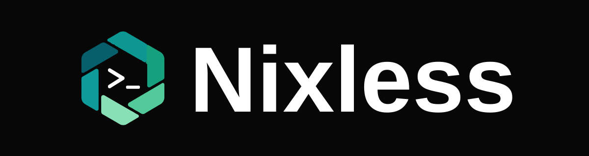

  

  
  
  

## What this is

Nixless is Fred's operating-system exploration: **model-as-appliance VMs** on hex (his Proxmox box).
A VM whose whole job is to be the model, with nothing else on it.

M0 and M1 are done, and M1 passed on hex (16 cores, AVX-512, idle cost 0.03% of one host core). M2 is under way: the kernel reads a GGUF model handed over as a boot module, validates it, and runs a Q8_0 matrix-vector product that matches NumPy exactly. No inference yet.

Build and check: `zig build iso`, then `scripts/qemu-boot-check.sh` (Zig 0.16.0 via mise; see [DESIGN.md](DESIGN.md) section 13.1).

## Design

- [DESIGN.md](DESIGN.md): the PRD and design.

Nixless is written from scratch in Zig and assembly, from the firmware up.

Always bootable: every commit on main must produce an ISO that boots on hex in Proxmox (SeaBIOS and OVMF) and reaches its serial boot log; see [DESIGN.md](DESIGN.md) section 0.

Good neighbor: idle cores halt and wake on interrupts, so an idle Nixless VM uses near-zero host CPU on hex; see [DESIGN.md](DESIGN.md) section 0b.

## Ideas

Headings only for now. Nothing here is implemented.

### Appliance shape

### Boot and kernel

### Inference

### Running on hex

### Open questions

## License

TBD.
